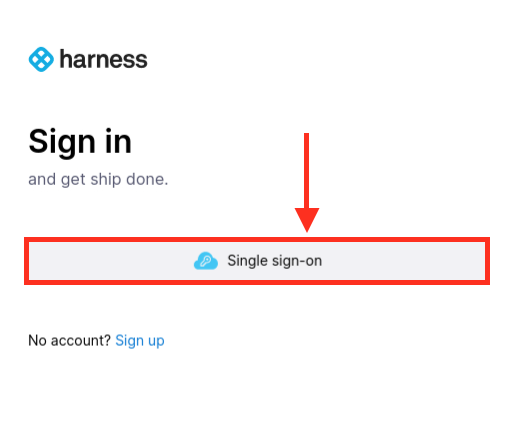
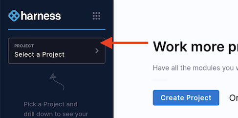

<h2 class="cyan">👋 Welcome to your Harness Workshop Sandbox!</h2>

 

> [!IMPORTANT]
> Make sure you scroll to the bottom of the lab guide in each lab
> 

 

## A Sandbox Account has been provisioned for you to use for the duration of this workshop.
Login to your **Harness Sandbox** account using the details provided below.👇

> [!IMPORTANT]
> 1) The Instruqt platform this workshop is delivered by uses a browser in browser to simplify the hands-on lab experience.
> 1) Zoom content by clicking in the browser in browser and pressing:
>    1) Mac:`⌘ -`
>    1) PC: `CTRL -`
> 1) *If you experience any issues you can access the Harness Platform in your browser tab by clicking: \
>  [button label="Harness Platform" variant="success"](tab-2) tab*

Harness Account
===
## Harness Sandbox Account details:
|  |   |
| ----- | ----- |
| **Username**    |<pre>`[[ Instruqt-Var key="HARNESS_USER" hostname="sandbox" ]]`</pre>|
| **Password**    |<pre>`[[ Instruqt-Var key="HARNESS_PWD" hostname="sandbox" ]]`</pre>|

> [!NOTE]
> *All credentials for this lab can always be found on the:  
>  [button label="Lab Credentials" variant="success"](tab-1) tab*

---

Signing In
===

> 📝 *Click Single sign-on*  
> *Login using the credentials above:*  
> 

Project Selection
===

> A **Project** has been created for you and is where you will perform the tasks in the subsequent labs. \
> Click on `Select a Project` \
> Click on project `[[ Instruqt-Var key="HARNESS_PRJ_ID" hostname="sandbox" ]]` \
   

Conclusion
===

Click the **Check** button to continue.
