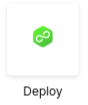
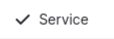
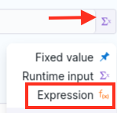
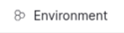
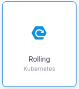
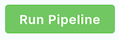
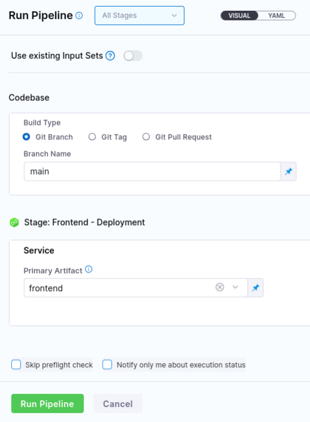

<h2 class="cyan">Continuous Deployment - Frontend</h2>

  

## Time to deploy our new artifact
> Go back to the **Harness** `Pipeline Studio` by clicking the **Edit Pipeline** button at the top of the screen \
>    

> 1) Click `+Add Stage`
> 1) Choose **Deploy** stage type \
>    
> 1) Configure with the details below ↓

> **Deploy Stage**
> - Stage Name: <pre>`Frontend - Deployment`</pre>
> - Deployment Type: `Kubernetes`
> - Click **Set Up Stage**

> - On the **Service** tab \
>    
>    1) Click `+ Add Service`
>    1) Configure with the details below ↓

> **New Service**
> - ***About the Service***
>   - Name: <pre>`frontend`</pre>
>   - Store: `Inline`
> - ***Service Definition***
> - Deployment Type: `Kubernetes`
> - Manifests: `+ Add Manifest`
>   - ***Manifest***
>     1) Manifest Type: `K8s Manifest`
>        - Click **Continue >**
>     1) Manifest Source: `Code`
>        - Click **Continue >**
>     1) Manifest Details
>        -  Manifest Identifier: <pre>`templates`</pre>
>        -  Repository Name: `[[ Instruqt-Var key="HARNESS_REPO" hostname="sandbox" ]]`
>        -  Branch: <pre>`main`</pre>
>        -  File/Folder Path: <pre>`harness-deploy/frontend/manifests`</pre>
>        -  Values.yaml:
>           - Click `+ Add File`
>           <pre><code>harness-deploy/frontend/values.yaml</code></pre>
>        - Click **Submit >**
> - Artifacts: `+ Add Artifact Source`
>   - ***Artifact***
>     1) Artifact Repository Type: `Google Artifact Registry`
>     2) Artifact Repository: `workshop-gar`
>     3) Artifact Location
>        -  Artifact Source Identifier: <pre>`frontend`</pre>
>        -  Project Id: <pre>`seworkshop`</pre>
>        -  Region: `us`
>        -  Repository Name: <pre>`seworkshop`</pre>
>        -  Package: <pre>`harness-workshop`</pre>
>        -  Version: <pre><code><+variable.username>-<+pipeline.sequenceId></code></pre> \
>            (change the field type to expression) \
>            
>     - Click **Submit >**
>   - Click **Save**
> - Click **Continue >**

> - On the **Environment** tab \
>    
>    1) Specify Environment: `Dev`
>    1) Specify Infrastructure: `K8s Dev`

> [!NOTE]
> With Harness, a platform team can easily create and manage environments and infrastructure, then developers can use them to deploy their applications.

> - On the **Execution** tab \
>    
>    1) Select: `Rolling` \
>       
>    1) Click **Use Strategy**

> [!NOTE]
> The frontend is a static application so there isn't a need for `Canary` or `Blue/Green` at this time.  
> In the next Lab we will use the `Canary` release strategy for our backend service.

### Execute your Pipeline
> Click **Save** in the top right to save your pipeline. \
>   

> Now click **Run** to execute the pipeline \
>   
> Then click **Run Pipeline** \
>   

> The build should run using:  
> 
> - Branch Name: `main`
> - Stage: **Frontend - Deployment**
>   - Primary Artifact: `frontend`

===============

Click the **Check** button to continue.
