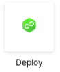
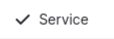
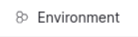
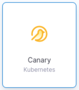
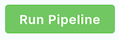
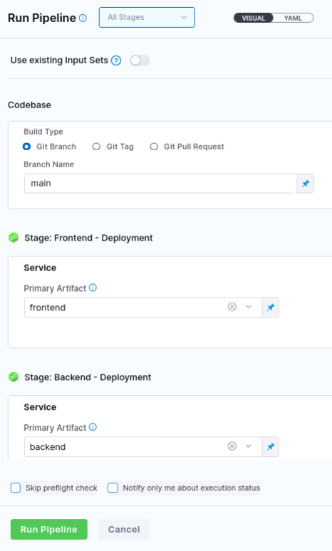

<h2 class="cyan">Continuous Deployment - Backend</h2>

  

## Now let's deploy the backend artifact
> Go back to the **Harness** `Pipeline Studio` by clicking the **Edit Pipeline** button \
>    

> 1) Click `+Add Stage`
> 1) Choose **Deploy** stage type \
>    
> 1) Configure with the details below ↓

> **Deploy Stage**
> - Stage Name: <pre>`Backend - Deployment`</pre>
> - Deployment Type: `Kubernetes`
> - Click **Set Up Stage**

> - On the **Service** tab \
>    
>    1) Click `Select Service`
>       1) Select: `backend` \
>        *(this has been preconfigured for you)*
>    1) Click **Continue >**

> - On the **Environment** tab \
>    
>    1) Click `Propagate Environment From`
>       1) Select: `Stage [Frontend - Deployment]`
>    1) Click **Continue >**

> - On the **Execution** tab \
>    
>    1) Select: `Canary` \
>       
>    1) Click **Use Strategy**

### Execute your Pipeline
> Click **Save** in the top right to save your pipeline. \
>   

> Now click **Run** to execute the pipeline \
>   
> Then click **Run Pipeline** \
>   

> The build should run using:  
> 
> - Branch Name: `main`
> - Stage: **Frontend - Deployment**
>   - Primary Artifact: `frontend`
> - Stage: **Backend - Deployment**
>   - Primary Artifact: `backend`

===============

Click the **Check** button to continue.
