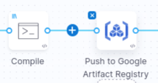
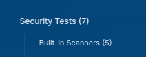
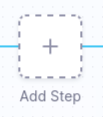
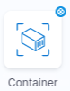
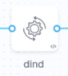
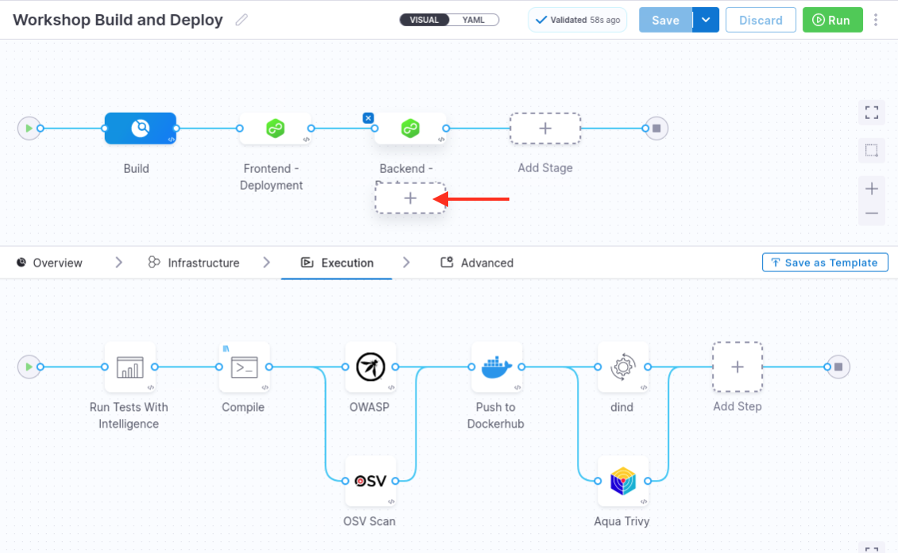
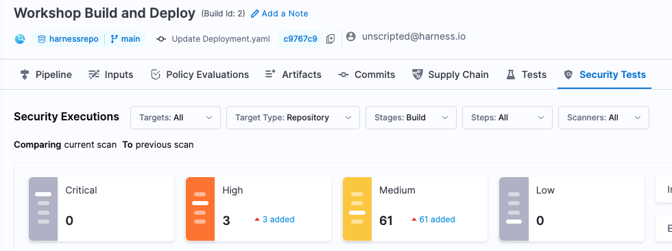
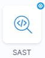

<style type="text/css" rel="stylesheet">
hr.cyan { background-color: cyan; color: cyan; height: 2px; margin-bottom: -10px; }
h2.cyan { color: cyan; }
</style><h2 class="cyan">Integrate Security Scanners</h2>
<hr class="cyan">
<br><br>

## Why this matters for your MCP server
Your MCP server sits on top of open-source packages. A vulnerable package runs with your server's credentials, and a tool description that leaves out an expert caveat lets an agent give a confident, wrong answer. In this lab you will add a small starter MCP server to your repo, let the pipeline catch both problems, fix them, and watch the release go through.

> [!NOTE]
> The starter server is a stand-in so everyone gets the same results. It is not deployed. The same steps apply to the `requirements.txt` and tool descriptions in your own hackathon repo.

## Step 1: Add a starter MCP server to your repo
> [!IMPORTANT]
> **Don't see `devsecops-repo` in Code Repository?** The lab creates it for you when this challenge starts, and it can take a minute or two to appear. Refresh the Code Repository page. Still missing after 2 minutes? Post in chat and we will create it for you.

> 1) In the **Harness Platform** tab, open the **Code Repository** module and select your repository: `[[ Instruqt-Var key="HARNESS_REPO" hostname="sandbox" ]]`
> 1) Click **New File**. For the file name enter <pre>`mcp-server/requirements.txt`</pre> and paste the content below

```
mcp>=1.9.0
requests==2.25.1
urllib3==1.26.4
```

> 1) Click **Commit changes**, choose to commit directly to `main`, and confirm. You will land inside the new `mcp-server` folder. Stay there.
> 1) Click **New File**. For the file name enter just <pre>`server.py`</pre> and paste the content below. Because you are already in the `mcp-server` folder, that is where the file goes.

```python
"""Starter MCP server for the GSA MCP workshop (stand-in, not deployed)."""
from mcp.server.fastmcp import FastMCP

mcp = FastMCP("federal-open-data")


@mcp.tool()
def get_places_health_estimate(county: str, measure: str, year: int) -> dict:
    """Get a CDC PLACES health estimate (for example depression or dentist visits)
    for a county or census tract and survey year."""
    ...


@mcp.tool()
def get_ag_census_farm_count(state: str) -> dict:
    """Get the number of farms in a state from the USDA NASS Census of Agriculture.
    Caveat: the Census of Agriculture is released every five years. Do not mix it
    with monthly or weekly NASS market reports when comparing numbers."""
    ...
```

> 1) Click **Commit changes**, choose to commit directly to `main`, and confirm
> 1) Check that `requirements.txt` and `server.py` now sit side by side in the `mcp-server` folder.

> [!IMPORTANT]
> Look closely at the two tool descriptions. The Ag Census tool gives the agent its caveat. The PLACES tool does not. You will see what that costs in a few minutes.

## Now let's add Harness Built-in Scanners
Harness offers robust and versatile solutions tailored to meet the stringent demands of even the most discerning security professionals.

> Go back to the **Harness** `Pipeline Studio` by clicking the **Edit Pipeline** button \
>    

### Adding SCA Scanners
===
> 1) In the existing pipeline, within the ***Build*** stage `after` the ***Compile*** step click on `+ Add Step` \
>     
> 1) Select `Add Step` \
>    
> 1) Select `Built-in Scanners` \
>    
> 1) Select `SCA`
> 1) Click **Add Scanners**. This adds two scanners, OWASP and OSV.
> 1) Delete the OWASP step: hover over it in the pipeline and click the **x**. OSV checks the same open-source dependencies and runs much faster, so one is enough for today.
> 1) Select the remaining step and rename it to <pre>`OSV Scan`</pre>
> 1) Click **Apply Changes** in the top right

### Adding Container Image Scanner
===
> 1) In the existing pipeline, within the ***Build*** stage `after` the ***Push to Google Artifact Registry*** step click on `+ Add Step` \
>     
> 1) Select `Add Step` \
>    
> 1) Select `Built-in Scanners` \
>    
> 1) Select `Container` from the Step Library and configure with the details below ↓

> **Built-in Container Scanners**
> - Check: `Aqua Trivy`
>   - *`Uncheck` the other scanners*
> - **Container Information**
>   - Type: `Docker V2`
>   - Image: <pre><code>seworkshop/seworkshop/harness-workshop:<+variable.username>-<+pipeline.sequenceId></pre></code>
> - Click **Add Scanners**

> 1) Select the step we just added
>    1) Rename the step to <pre>`Aqua Trivy`</pre>
>    1) Under the ***Container Image*** section update
>       1) Domain: <pre><code>us-docker.pkg.dev</pre></code>
>    1) Click **Apply Changes** in the top right
> 1) Then click on the `dind` step \
>     \
>    and configure with the details below ↓

> **Configure Background Step**
> - **Additional Configuration  ⏷**
>   - Container Registry: `workshop-docker`
>   - (You may need to click the `All` or `Org` tab to see the registry)
> - Click **Apply Changes** in the top right

### DAST Scan Template Owned by the Security Team
===
Now we are going to add a `Stage` template to run DAST Scans.

> [!NOTE]
> Typically, the security team owns these scans, and as such, they will manage and version the template as needed. They simply require that we include it in our pipeline.

> 1) In the existing pipeline, click on the `+` icon under the ***Backend - Deployment*** stage to add a new stage \
>    <br>
> 1) Select `Use template` \
>    
> 1) Select `DAST Scans` template and click `Use template`
> 1) Name the stage <pre>`DAST Scans`</pre>

<br>

### Add the Agent Evaluation step
This step asks three golden questions with known answers and required expert caveats. If tool accuracy or caveat compliance falls below threshold, the Build stage fails and nothing deploys.

> 1) In the ***Build*** stage, `after` the ***Aqua Trivy*** step click on `+ Add Step`
> 1) Select `Add Step`, then select `Run`
> 1) Configure with the details below ↓

> **Agent Evaluation**
> - Name: <pre>`Agent Evaluation`</pre>
> - Shell: `Sh`
> - Command: paste the script below ↓
> - Expand **Optional Configuration** and set:
>   - Container Registry: `workshop-docker`
>     - (You may need to click the `All` or `Org` tab to see the registry)
>   - Image: <pre>`python:3.12-slim`</pre>
> - Click **Apply Changes** in the top right, then **Save** the pipeline

```
python3 - <<'EOF'
import ast, pathlib, re, sys
GOLDEN = [
    {"q": "What percent of adults visited a dentist in Montgomery County, Maryland? Use CDC PLACES health estimates.",
     "tool": "get_places_health_estimate", "caveat": None},
    {"q": "Did the CDC PLACES depression estimate for Montgomery County go up between 2019 and 2022?",
     "tool": "get_places_health_estimate", "caveat": "year-over-year"},
    {"q": "How many farms are in Iowa according to the USDA Census of Agriculture?",
     "tool": "get_ag_census_farm_count", "caveat": "every five years"},
]
src = pathlib.Path("mcp-server/server.py").read_text()
tools = {n.name: (ast.get_docstring(n) or "") for n in ast.walk(ast.parse(src)) if isinstance(n, ast.FunctionDef)}
words = lambda s: set(re.findall(r"[a-z]{4,}", s.lower()))
correct = caveats_ok = caveats_needed = 0
print("AGENT EVALUATION (stand-in agent: picks a tool by its description, repeats only the caveats that description gives it)")
for g in GOLDEN:
    pick = max(tools, key=lambda t: len(words(g["q"]) & words(t.replace("_", " ") + " " + tools[t])))
    ok_tool = pick == g["tool"]; correct += ok_tool
    line = f"- {g['q'][:70]}...\n    tool: {pick} [{'PASS' if ok_tool else 'FAIL'}]"
    if g["caveat"]:
        caveats_needed += 1
        ok_cav = ok_tool and g["caveat"] in tools[pick].lower(); caveats_ok += ok_cav
        line += f"  caveat '{g['caveat']}': [{'PASS' if ok_cav else 'FAIL'}]"
    print(line)
acc = correct / len(GOLDEN); cav = caveats_ok / caveats_needed
print(f"\nTool accuracy: {acc:.0%} (threshold 100%)   Caveat compliance: {cav:.0%} (threshold 100%)")
if acc < 1 or cav < 1:
    print("RELEASE BLOCKED: fix the tool description in mcp-server/server.py and commit again."); sys.exit(1)
print("RELEASE ALLOWED")
EOF
```

> [!NOTE]
> The "agent" in this step is a deterministic stand-in: it picks a tool by matching the question to tool descriptions, and it can only repeat the caveats those descriptions give it. In your own project, run the same golden questions against your real agent and model, and re-run them every time the model version changes.

> [!IMPORTANT]
> The **Check** button only confirms your pipeline is set up. If you click it, you will see Success and a **Next** button. Do not click Next yet. Finish Step 2 and Step 3 below first.

### Execute your updated Pipeline
===
> Click **Save** in the top right to save your pipeline. <br>
> 

> Now click **Run** to execute the pipeline. <br>
> 

### Security Scan Results
The scans take ~3 minutes to run. <br>
After the execution is complete, go to the `Vulnerabilities` tab to see the *deduplicated*, *normalized* and *prioritized* list of `vulnerabilities` discovered across your scanners. <br>


## Step 2: Triage what the pipeline caught
The first run is supposed to fail at the ***Agent Evaluation*** step. That is the gate doing its job. The scanners report what they find, but they do not stop the build on their own. The evaluation gate does.

> [!NOTE]
> Did your first run succeed instead? Open the ***Build*** stage of the run and look for the ***Agent Evaluation*** step. If it is not there, the step was not saved, or you clicked **Skip** on this challenge. Add it using **Add the Agent Evaluation step** above, click **Save**, and run the pipeline again.
> 1) Open the ***Agent Evaluation*** step log. You should see `Caveat compliance: 50%` and `RELEASE BLOCKED`. The deployment stages did not run.
> 1) Open the `Vulnerabilities` tab. The scanners found well over a hundred issues across the demo app and its container. To find the ones from your MCP server, search for the two packages you pinned in `mcp-server/requirements.txt` in Step 1. Those exact versions have known vulnerabilities, which is why we chose them. Type <pre>`urllib3`</pre> in the search box, open the highest-severity finding, and read the remediation guidance. Then search for `requests`.

> [!NOTE]
> In your own project, you won't know the package names in advance. Sort by severity, or filter by the scan target, and start from the top. The pipeline deduplicates and prioritizes the findings so you don't have to.

## Step 3: Fix it and ship it
> 1) In **Code Repository**, open `mcp-server/requirements.txt`, click **Edit**, replace the `requests` and `urllib3` lines with the lines below, and commit to `main`

```
requests==2.34.2
urllib3==2.8.0
```

> 1) Open `mcp-server/server.py`, click **Edit**, and replace the line `for a county or census tract and survey year."""` with the three lines below. Keep the indentation. Commit to `main`

```
    for a county or census tract and survey year.
    Caveat: year-over-year comparisons are not valid. PLACES estimates are modeled
    from decennial census data, so differences between years are not real trends."""
```

> 1) Go back to your pipeline and click **Run**

The ***Agent Evaluation*** step should now report `Caveat compliance: 100%` and `RELEASE ALLOWED`, the deployments run, and the `requests` and `urllib3` findings should be gone from `Vulnerabilities`.

> [!NOTE]
> This is how an expert caveat stays true as your server changes. The rule lives in a test, and the pipeline refuses to ship without it.

Conclusion
===

Click the **Check** button to continue.

***BONUS***
===
### Adding SAST Scanner
> 1) In the existing pipeline, within the ***Build*** stage `under` the ***OSV Scan*** step click on `+ Add Step` \
>     
> 1) Select `Add Step` \
>    
> 1) Select `Built-in Scanners` \
>    
> 1) Select `SAST` and click **Add Scanner**
> 1) Rename the step to `Semgrep`

===============

Click the **Check** button to continue.
