<h2 class="cyan">Continuous Verification</h2>

  

## Now let's add Continuous Verification
> Go back to the **Harness** `Pipeline Studio` by clicking the **Edit Pipeline** button \
>    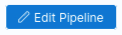
> 1) In the right nav, click on `Advanced Options` \
>    
>    1) Under **Stage Execution Settings** click the radio button next to `Yes` \
>       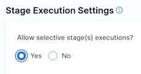
>     *This will allow us to execute an individual **Stage** of our pipeline*
>    1) Click **Apply Changes** in the top right
> 1) Hover over the ***Approval*** stage and click the **X** to delete it \
>    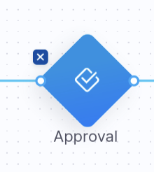
> 1) Click on the ***Backend - Deployment*** stage
> 1) Click on the **Environment** tab \
>    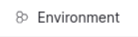
>    1) Click on the radio button next to \
>     `Deploy to Different Environment`
>    1) Specify Environment: `Dev`
>    1) Specify Infrastructure: `K8s Dev`
>    1) Click **Continue >**
> 1) On the **Execution** tab \
>    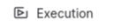
>    1) `Between` the ***Canary Deployment*** and the ***Canary Delete*** steps
>    1) Click on the `+` icon to add a new step \
>       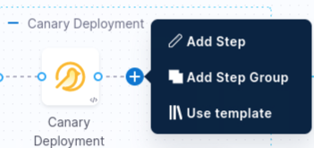
>    1) Select `Add Step`
>    1) Select `Verify` from the Step Library \
>       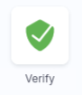
>    1) Configure with the details below ↓

> **Verify**
> - Name: <pre>`Verify`</pre>
> - Continuous Verification Type: `Canary`
> - Sensitivity: `Low`
> - Duration: `5mins`
> - Click **Apply Changes** in the top right

> [!NOTE]
> ***Continuous Verification Sensitivity***  
> This is to define how sensitive the ML algorithms are going to be on deviation from the baseline.

Execute your Pipeline
===
> Click **Save** in the top right to save your pipeline.  
> 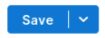

> Now click **Run** to execute the pipeline.  
>  
> - Click the **All Stages** dropdown
> - Select only the `Backend - Deployment` stage \
>    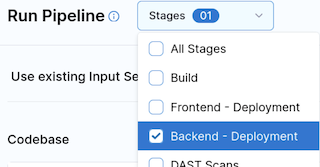
> - Then Click **Run Pipeline**

> [!NOTE]
> It may take a minute or two for ***Continuous Verification*** to start.

Visualize the Canary Deployment
===
### While the canary deployment is ongoing see if you can spot the canary!
> #### Switch to the [button label="Demo App" variant="success"](tab-1) tab to continue
> - Click the `Check Release` button \
>  *(Don't worry! Keep on clicking it!)* \
>    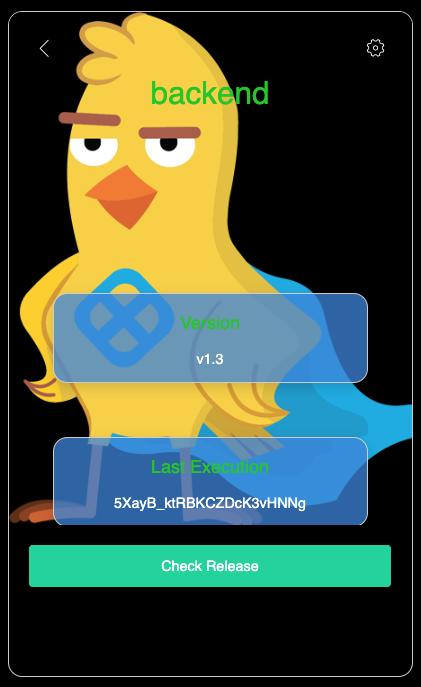

 

### Distribution Test
> - Now click on the `Start` button on the **Distribution Test** panel
> - Then click the **Play** `▶️` button to observe the traffic distribution \
>    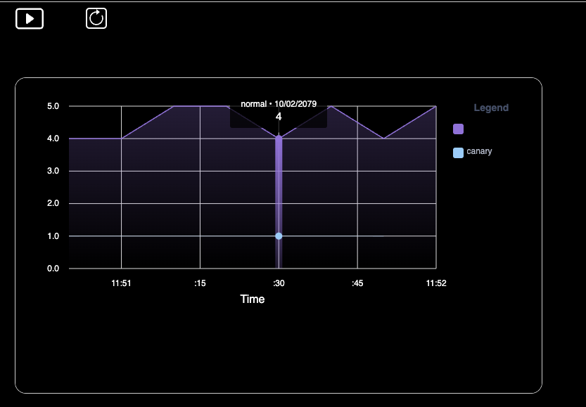

 

### Validate the outcome of the verification on the pipeline execution details
> #### Switch to the [button label="Harness Platform" variant="success"](tab-0) tab to continue
> 1) Toggle `Console View`
> 2) Select the `Verify` step
> 3) Uncheck the option to `Display only anomalous metrics and affected nodes`
> 4) Click the `⏷` to view the details
> 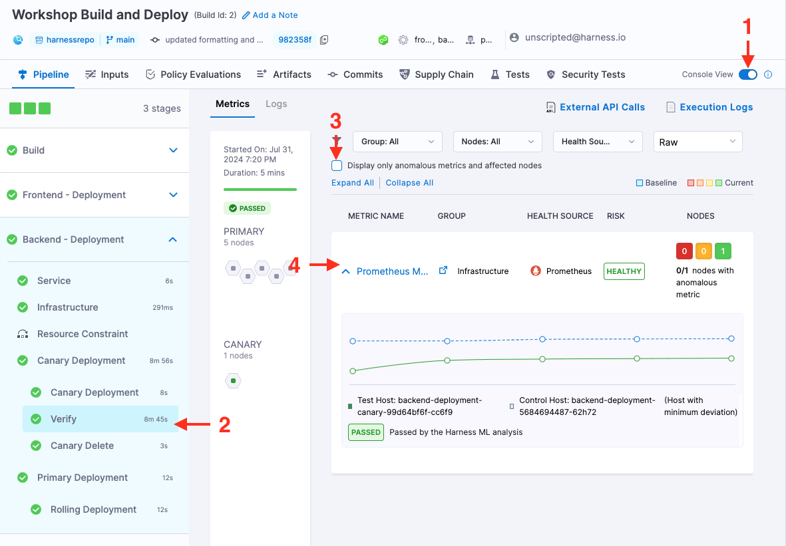

> [!NOTE]
**This is just the beginning** 
> - `Harness Continuous Verification` integrates with APMs and logging tools to verify that the deployment is running safely and efficiently.
> - Harness CV applies **machine learning** algorithms to every deployment for identifying normal behavior.
> - This allows Harness to identify and flag anomalies in future deployments.
> - During the Verify step, Harness CV `automatically` triggers a **rollback** if anomalies are found.

Conclusion
===
# Congratulations on completing this **Harness workshop**! 🏆
### That's all for now. We hope you enjoyed your hands-on experience with the Harness platform.   📈 We are always looking to improve so please rate your experience and share any suggestions or issues you may have encountered. Thank you!

===============

Click the **Check** button to continue.
