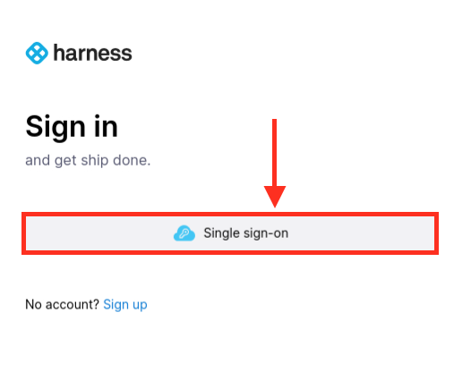
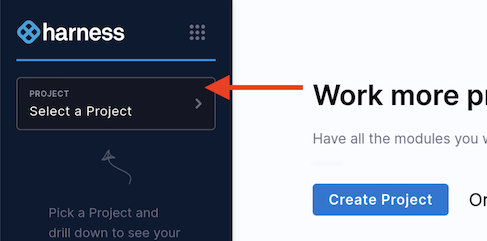

<h2 class="cyan">Welcome to Your Harness CD Test Drive</h2>

 

A sandbox account has been provisioned for you. Log in using the credentials below.

> [!NOTE]
> *If you experience any issues with the embedded browser, click: \
>  [button label="Harness Platform" variant="success"](tab-2) to open Harness in a new tab*

Harness Account
===
## Your Sandbox Credentials
|  |   |
| ----- | ----- |
| **Username**    |<pre>`[[ Instruqt-Var key="HARNESS_USER" hostname="sandbox" ]]`</pre>|
| **Password**    |<pre>`[[ Instruqt-Var key="HARNESS_PWD" hostname="sandbox" ]]`</pre>|

> [!NOTE]
> *Credentials are always available on the:  
>  [button label="Lab Credentials" variant="success"](tab-1) tab*

---

Signing In
===

> Click **Single sign-on** and log in with the credentials above:  
> 

Project Selection
===

> A **Project** has been created for you. This is your personal sandbox for this test drive. \
> Click on `Select a Project` \
> Click on project `[[ Instruqt-Var key="HARNESS_PRJ_ID" hostname="sandbox" ]]` \
> 

Conclusion
===

Click the **Check** button to continue.
