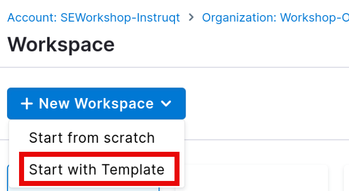
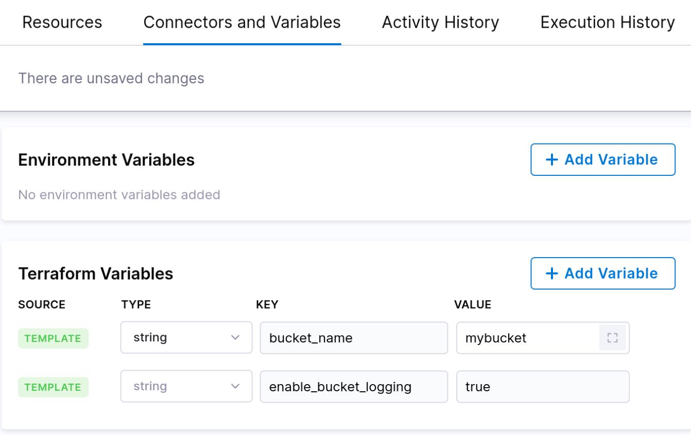

<h2 class="cyan">PR Triggers and Validation</h2>

 

## Let's create a workspace from a standard templated architecture
> - Click on **Workspaces** in the left Nav
> - Click the `+New Workspace` button and select `Start with Template`\
>     

> **New Workspace**
> - Name: <pre>`workspace-from-template`</pre>
> - Click **Start**
> - Select the `Standard 3x AWS EC2` template and then click on the `Use Template` button
> -  In your new workspace, select the  **Connectors and Variables** tab

> [!NOTE]
> Note that there are two variables, but only one is editable. Template owners are able to mark each variable in the template as editable by the consumers of the template or not. This allows the infrastructure team to provide flexibility to their consumers and while still maintaining control of settings that should be centrally defined.
> 

>  - On the right hand side of the tab, click **+ Add Connector**
>  - Click the select box that appears just below the **+ Add Connectors** button and select  the `instruqt-workshop-connector` connector.
>  - Click on the **Save Changes** button

> Now we can provision our workspace!
> - Click on **Pipelines** in the left Nav
> - Click on the **IaCM Provision** pipeline
> - Click **Run** \
>     
> - Then select your `workspacefromtemplate` **Workspace** to execute the pipeline
> - Click **Run Pipeline**
> - Review and approve the changes

 
NOTE: Now sit back, grab a coffee and wait until the instructor catches up and says that it's time to continue
 

> - In your existing pipeline execution, click the `**Re-run**` button

 
 

# Congratulations on completing this `Harness IaCM` workshop!
> [!IMPORTANT]
> That's all for now. We hope you enjoyed your hands-on experience with the Harness IaCM module. We are always looking to improve so please rate your experience and share any suggestions or issues you may have encountered. Thank you!

===============

Click the **Check** button to continue.
