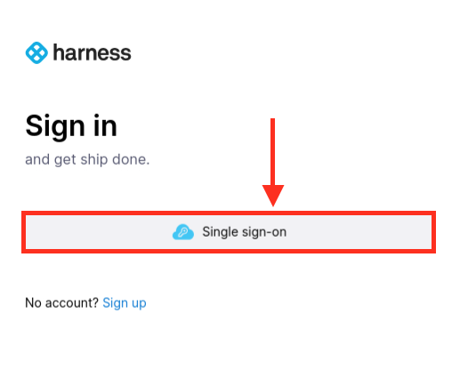
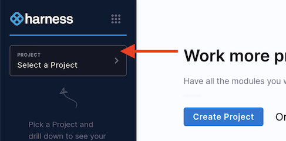

<h2 class="cyan">ようこそ</h2>

 

あなた専用の Harness プロジェクトを用意しました。アプリが入った Git リポジトリ、アーティファクトレジストリ、専用の Kubernetes クラスターが含まれています。次の認証情報でログインしてください。

| | |
| ----- | ----- |
| **ユーザー名** |<pre>`[[ Instruqt-Var key="HARNESS_USER" hostname="sandbox" ]]`</pre>|
| **パスワード** |<pre>`[[ Instruqt-Var key="HARNESS_PWD" hostname="sandbox" ]]`</pre>|

> [!NOTE]
> 認証情報はいつでも [button label="ラボ認証情報" variant="success"](tab-1) タブで確認できます。
> 埋め込みブラウザの動作がおかしい場合は、[button label="Harness（新しいウィンドウ）" variant="success"](tab-2) を開いてください。
> 「not authorized」と表示される場合は、すでに別のユーザーで Harness にサインインしています。リンクをシークレットウィンドウ（プライベートウィンドウ）に貼り付けて、そこでサインインしてください。

> [!IMPORTANT]
> **日本語の入力について:** **Harness** タブは、ブラウザ画面をリモートから表示する仕組みです。そのため、日本語入力（IME）が使えない場合があります。日本語を入力したいときは、[button label="Harness（新しいウィンドウ）" variant="success"](tab-2) から通常のブラウザで操作してください。

サインイン
===

1) **Harness** タブで **Single sign-on** をクリックし、上記の認証情報でログインします \
   
2) **Select a Project** をクリックし、`[[ Instruqt-Var key="HARNESS_PRJ_ID" hostname="sandbox" ]]` を選択します \
   

**Check** をクリックして次に進みます。
