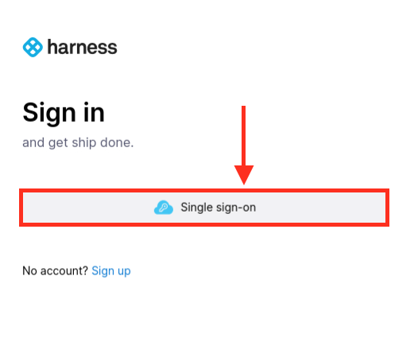
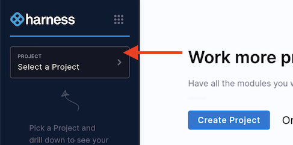

<h2 class="cyan">Welcome</h2>

 

Harness has set up a personal project for you, with an empty Git repo holding your app, an
artifact registry, and your own Kubernetes cluster. Log in with these credentials.

| | |
| ----- | ----- |
| **Username** |<pre>`[[ Instruqt-Var key="HARNESS_USER" hostname="sandbox" ]]`</pre>|
| **Password** |<pre>`[[ Instruqt-Var key="HARNESS_PWD" hostname="sandbox" ]]`</pre>|

> [!NOTE]
> Your credentials are always on the [button label="Lab Credentials" variant="success"](tab-1) tab.
> If the embedded browser misbehaves, open [button label="Harness (new window)" variant="success"](tab-2).
> If it says you're not authorized, you're already signed in to Harness as someone else: copy the
> link into a private/incognito window and sign in there.

Sign in
===

1) In the **Harness** tab, click **Single sign-on** and log in with the credentials above \
   
2) Click **Select a Project** and pick `[[ Instruqt-Var key="HARNESS_PRJ_ID" hostname="sandbox" ]]` \
   

Click **Check** to continue.
